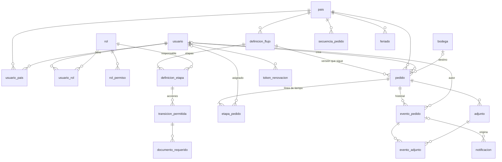

# Modelo de datos — Decokasa

**Fecha:** 2026-10-10 · **Fase 0, paso 0.9** · **Fuentes:** `documentos/requerimientos.md` (sección 4.6 y respuestas del cliente), `documentos/arquitectura.md`, `documentos/api/openapi.yaml` y `documentos/adr/`. Correspondencia con JPA revisada con la skill `ecc:jpa-patterns`.

Esquema PostgreSQL 17 para el MVP de Ecuador: 21 tablas (con `usuario_rol`, agregada el 2026-10-12). Es solo diseño; las migraciones Flyway se escriben desde la fase 1 (`backend/src/main/resources/db/migration/`), y este documento no contiene SQL ejecutable.

**Marcas:**
- Sin marca: requisito de `requerimientos.md`, o consecuencia directa de uno.
- **[P]**: propuesta del equipo, no aprobada.
- **⏸**: pendiente del cliente.

## 1. Decisiones generales

| Tema | Decisión | Origen |
| --- | --- | --- |
| Identificadores | `uuid` en todas las tablas de negocio, generado por la aplicación. **[P]** UUIDv7, que es ordenable por tiempo y no fragmenta los índices como un UUID aleatorio | El contrato OpenAPI usa `uuid`. La alternativa sería un `bigint` interno más un `uuid` público; es más eficiente, pero agrega un mapeo |
| Fechas y horas | `timestamptz` (se guarda en UTC); la zona `America/Guayaquil` se aplica en el dominio y en la API. Fechas sin hora: `date` | ADR-0006 |
| Textos | `text`, con `CHECK` de longitud donde el contrato fija un máximo | Recomendación de la skill `postgres-patterns` |
| Valores cerrados (estado, acción, tipo de flujo) | `text` con `CHECK (... IN (...))`, sin tipos `ENUM` de PostgreSQL | **[P]** Agregar un valor es una migración simple, y en JPA se mapea con `@Enumerated(STRING)` |
| Concurrencia | Columna `version bigint` (bloqueo optimista) en `pedido`, `usuario`, `bodega` y `secuencia_pedido` | En `usuario`: **D10, aprobado el 2026-10-13**, respalda el 409 `VERSION_DESACTUALIZADA` del contrato (`Usuario.version`). En `pedido`: **[P]** respalda el 409 `ETAPA_CAMBIO`. `rol` no tiene versión todavía (pendiente) |
| Esquema | Flyway es dueño del esquema; Hibernate solo valida (`ddl-auto=validate`) | ADR-0001 (Flyway) y skill `jpa-patterns` |
| Borrados | No hay borrado físico de pedidos, eventos ni adjuntos. Usuarios y bodegas se desactivan con `activo` / `activa`; las FK hacia `usuario` no usan `ON DELETE CASCADE`, así el historial de un usuario desactivado se conserva | Requisitos 4.6 y 4.7, e invariante del historial |

## 2. Diagrama entidad-relación



## 3. Tablas

### 3.1 Usuarios, roles y países (módulo `usuarios`)

**`pais`**

| Columna | Tipo | Restricciones | Nota |
| --- | --- | --- | --- |
| `codigo` | `text` | PK, `CHECK (codigo ~ '^[A-Z]{2}$')` | EC, CO |
| `nombre` | `text` | NOT NULL | |
| `activo` | `boolean` | NOT NULL | EC verdadero; CO falso en v1 (ADR-0009) |

**`rol`**

| Columna | Tipo | Restricciones | Nota |
| --- | --- | --- | --- |
| `id` | `uuid` | PK | |
| `codigo` | `text` | NOT NULL, UNIQUE, `CHECK (codigo ~ '^[a-z_]{3,40}$')` | `admin`, `asistente_compras`, `marketing`, `compras_china`, `logistica`, `asistente_china` y `consulta` (conservado por decisión del equipo, alcance ⏸); el admin puede crear más (requisito 4.6). El `CHECK` es el mismo formato que valida `CodigoRol` en el dominio |
| `nombre` | `text` | NOT NULL, `CHECK (char_length(nombre) BETWEEN 1 AND 100)` | Nombres de los 7 iniciales (aceptados el 2026-10-12): Administrador, Asistente de compras, Marketing y codificación, Compras China, Logística, Asistente de compras en China y Consulta |
| `creado_en` | `timestamptz` | NOT NULL | |

Los 7 roles iniciales tienen identificadores fijos (aceptados el 2026-10-12), iguales en todos los entornos: UUIDv7 válidos con la marca de tiempo 2026-10-12T00:00:00Z, de `01a12d68-b800-7000-8000-000000000001` (admin) a `…000000000007` (consulta). `MigracionesIT` comprueba la versión, la variante y la fecha.

**`rol_permiso`** — permisos del rol. **Pendiente:** la lista de permisos se define con los casos de uso de la fase 1; la migración V1 crea la tabla vacía.

| Columna | Tipo | Restricciones |
| --- | --- | --- |
| `rol_id` | `uuid` | FK → `rol.id`, parte de la PK |
| `permiso` | `text` | parte de la PK |

Las "etapas que atiende" el rol (requisito 4.6) no se guardan aquí. Se derivan de `definicion_etapa.rol_codigo`, para no tener dos fuentes (contrato: `Rol.etapasQueAtiende`, solo lectura).

**`usuario`**

| Columna | Tipo | Restricciones | Nota |
| --- | --- | --- | --- |
| `id` | `uuid` | PK | |
| `nombre` | `text` | NOT NULL | |
| `correo` | `text` | NOT NULL | Único sin distinguir mayúsculas (índice `lower(correo)`) |
| `usuario` | `text` | NOT NULL | Nombre de usuario; único sin distinguir mayúsculas |
| `telefono` | `text` | NOT NULL | Único. **[P]** Se guarda normalizado (solo dígitos y el `+`) para que el login por teléfono funcione con o sin espacios |
| `contrasena_hash` | `text` | NOT NULL | BCrypt (ADR-0002); nunca la contraseña |
| `activo` | `boolean` | NOT NULL DEFAULT true | Desactivado: no inicia ni renueva sesión, y sus tokens de renovación se revocan. No se borra (requisito 4.7) |
| `intentos_fallidos` | `integer` | NOT NULL DEFAULT 0, `CHECK (>= 0)` | Bloqueo tras 5 intentos fallidos (ADR-0002, decidido por el equipo el 2026-10-12). **Fuera de la versión (D10):** solo lo escribe el inicio de sesión, con una actualización propia que no cambia `version`; una edición del admin no lo sobrescribe |
| `bloqueado_hasta` | `timestamptz` | NULL | Fin del bloqueo de 15 min (ADR-0002). Fuera de la versión, igual que `intentos_fallidos` (D10) |
| `creado_en`, `actualizado_en` | `timestamptz` | NOT NULL | |
| `version` | `bigint` | NOT NULL | Bloqueo optimista de los datos administrativos (D10): empieza en 0, sube con cada edición del admin y se expone como `Usuario.version`. El inicio de sesión no la cambia |

**Límites de campos** (aceptados por Richard el 2026-10-12). Son los mismos en la base (`CHECK` de la migración V1), en la API (`openapi.yaml`, `minLength`/`maxLength`/`pattern`) y en los formularios del frontend (esquemas Zod, tarea 22). Si uno cambia, se cambian los tres a la vez. El dominio valida primero; la base es la última barrera.

| Campo | Base de datos | API | Nota |
| --- | --- | --- | --- |
| `usuario.nombre` | 1 a 200 caracteres | `minLength: 1`, `maxLength: 200` | |
| `usuario.correo` | Con `@` después del primer carácter; hasta 254 | `format: email`, `maxLength: 254` (`Correo`) | Único sin distinguir mayúsculas |
| `usuario.usuario` | 3 a 50 caracteres | `minLength: 3`, `maxLength: 50` | Único sin distinguir mayúsculas |
| `usuario.telefono` | `^\+?[0-9]{7,15}$` (ya normalizado) | Hasta 20 caracteres con espacios, guiones o paréntesis (`Telefono`) | El servidor normaliza antes de guardar; el resultado cumple el formato de la base |
| Contraseña | Solo se guarda el hash (`contrasena_hash`); la base no conoce la contraseña ni su largo | Al menos 8 caracteres y como máximo **72 bytes en UTF-8** (`contrasenaInicial`: `minLength: 8`, `maxLength: 72` como cota exterior y `x-max-bytes: 72`) | BCrypt solo procesa 72 bytes. Se mide en bytes, no en caracteres: "ñ" o "á" ocupan 2 y un emoji 4. Más de 72 bytes se rechaza (400 al crear o cambiarla; 401 al iniciar sesión); nunca se recorta en silencio. Formularios: `new TextEncoder().encode(valor).length <= 72` |
| `rol.codigo` | `^[a-z_]{3,40}$` | `pattern` de `CodigoRol` | Igual que `CodigoRol` en el dominio |
| `rol.nombre` | 1 a 100 caracteres | `minLength: 1`, `maxLength: 100` | |
| `rol_permiso.permiso` | 1 a 100 caracteres | `maxLength: 100` | Lista de permisos pendiente |
| `usuario.intentos_fallidos` | `>= 0` | No se expone | |

Los roles del usuario están en `usuario_rol`, no en esta tabla.

**`usuario_rol`** (decisión del equipo del 2026-10-12, no del cliente: uno o varios roles por usuario, asignados solo por el admin; requisito 4.7)

| Columna | Tipo | Restricciones | Nota |
| --- | --- | --- | --- |
| `usuario_id` | `uuid` | FK → `usuario.id`, parte de la PK | |
| `rol_id` | `uuid` | FK → `rol.id`, parte de la PK | No se puede borrar un rol asignado |
| `asignado_en` | `timestamptz` | NOT NULL | Cuándo se asignó, para auditoría (aceptado el 2026-10-12) |

- PK (`usuario_id`, `rol_id`): el mismo rol no se asigna dos veces. Índice en (`rol_id`) para "usuarios con este rol".
- **Usuario sin roles** (aceptado por Richard el 2026-10-12): la base lo permite, por ejemplo en una carga externa, pero ese usuario tiene **prohibido iniciar y renovar sesión**; lo impiden el dominio y el inicio de sesión (pruebas del paso 1.6). Crear o editar un usuario por la API exige **al menos un rol**; para retirar el acceso se **desactiva la cuenta**.

**`usuario_pais`**: `usuario_id` (FK) y `pais_codigo` (FK); PK compuesta. Índice en (`pais_codigo`).

**`token_renovacion`** (ADR-0002; renovación aprobada por el equipo el 2026-10-12: hasta 8 h con rotación)

| Columna | Tipo | Restricciones | Nota |
| --- | --- | --- | --- |
| `id` | `uuid` | PK | |
| `usuario_id` | `uuid` | NOT NULL, FK → `usuario.id` | |
| `familia_id` | `uuid` | NOT NULL | Una familia por inicio de sesión; las rotaciones la heredan. Si se reutiliza un token revocado, se revoca toda la familia |
| `token_hash` | `text` | NOT NULL, UNIQUE | SHA-256 del token; nunca el token en claro |
| `creado_en` | `timestamptz` | NOT NULL | |
| `expira_en` | `timestamptz` | NOT NULL | Vencimiento absoluto: inicio de sesión + 8 h, igual para toda la familia |
| `revocado_en` | `timestamptz` | NULL | Al rotar, cerrar sesión, desactivar al usuario o cambiar su contraseña |

- `CHECK (expira_en > creado_en)`.
- Renovar exige un token sin revocar ni vencer **y** un usuario activo con al menos un rol (requisito 4.7).
- Índices: (`usuario_id`) y (`familia_id`). [P] Una tarea programada borra las filas con más de 30 días desde su vencimiento.

### 3.2 Definiciones de flujo versionadas (módulo `flujos`)

> **Implementado en `V2__flujos_pedidos_historial.sql` (fase 2, paso 2.1, 2026-10-15)** con las decisiones técnicas del equipo P-02, P-04, S-1, S-2, S-3 y los triggers (plan de la fase 2). Ninguna es una respuesta del cliente. Las tablas de esta sección y de las secciones 3.3 y 3.4 describen lo que crea V2.

**`definicion_flujo`**

| Columna | Tipo | Restricciones | Nota |
| --- | --- | --- | --- |
| `id` | `uuid` | PK | |
| `pais_codigo` | `text` | NOT NULL, FK → `pais` | |
| `tipo_flujo` | `text` | NOT NULL, `CHECK (tipo_flujo IN ('A','B'))` | |
| `version` | `integer` | NOT NULL, `CHECK (version >= 1)` | |
| `vigente` | `boolean` | NOT NULL | Solo una versión vigente por país y tipo |
| `creada_en` | `timestamptz` | NOT NULL | |

- UNIQUE (`pais_codigo`, `tipo_flujo`, `version`).
- UNIQUE (`id`, `pais_codigo`, `tipo_flujo`): permite que `pedido` apunte al flujo con su país y su tipo, y que la base compruebe que coinciden.
- Índice único parcial (`pais_codigo`, `tipo_flujo`) `WHERE vigente`: garantiza una sola versión vigente.
- Las definiciones versionadas en datos son ADR-0004, aceptado por el equipo el 2026-10-15 (no es decisión del cliente). Los pedidos siguen apuntando a la versión con la que se crearon. Que una versión publicada no se modifique y que todo cambio cree una versión nueva sigue siendo **[P]**: el plan de la fase 2 prevé completar la versión 1 en la fase 4 mientras no haya pedidos reales (S-2, S-6, S-7).

**`definicion_etapa`**

| Columna | Tipo | Restricciones | Nota |
| --- | --- | --- | --- |
| `id` | `uuid` | PK | |
| `flujo_id` | `uuid` | NOT NULL, FK → `definicion_flujo` | |
| `numero` | `smallint` | NOT NULL, `CHECK (numero BETWEEN 1 AND 30)` | A1–A11 / B1–B12 |
| `nombre` | `text` | NOT NULL | |
| `rol_codigo` | `text` | NULL, FK → `rol.codigo`, `CHECK (rol_codigo IS NOT NULL OR automatica)` | Rol responsable. Nulo **solo** en etapas automáticas como Fin (S-1, decisión del equipo, 2026-10-15) |
| `plazo_estado` | `text` | NOT NULL, `CHECK (IN ('DEFINIDO','SIN_PLAZO','PENDIENTE'))` | `PENDIENTE`: el cliente no lo definió (⏸ Fabricación, Aduana, Incidencias); no equivale a `SIN_PLAZO` (A1, Fin) |
| `plazo_cantidad` | `integer` | NULL, `CHECK (> 0)` | Solo con `plazo_estado = 'DEFINIDO'` |
| `plazo_tipo` | `text` | NULL, `CHECK (IN ('HORAS_HABILES','DIAS_HABILES','DIAS_CORRIDOS'))` | ⏸ Tránsito de 45 días: hábiles o corridos |
| `automatica` | `boolean` | NOT NULL DEFAULT false | Solo Fin |

- UNIQUE (`flujo_id`, `numero`).
- `CHECK`: `plazo_estado = 'DEFINIDO'` si y solo si `plazo_cantidad` y `plazo_tipo` tienen valor; los dos son nulos a la vez.

**`transicion_permitida`** — una fila por acción permitida en una etapa (contrato: `DefinicionAccion`).

| Columna | Tipo | Restricciones | Nota |
| --- | --- | --- | --- |
| `id` | `uuid` | PK | |
| `flujo_id` | `uuid` | NOT NULL | Con `etapa_origen`, FK → `definicion_etapa (flujo_id, numero)` |
| `etapa_origen` | `smallint` | NOT NULL | Número de la etapa de origen dentro del flujo |
| `accion` | `text` | NOT NULL, `CHECK (IN ('ENVIAR','APROBAR','RECHAZAR','DEVOLVER_POR_ERROR','DEVOLVER_POR_PRODUCTO_NUEVO','REPORTAR_DEMORA','ELEGIR_BODEGA'))` | |
| `etapa_destino` | `smallint` | NULL; con `flujo_id`, FK → `definicion_etapa (flujo_id, numero)` | Nulo solo si se queda (`REPORTAR_DEMORA`, `ELEGIR_BODEGA`), con `CHECK` |
| `requiere_observacion` | `boolean` | NOT NULL | |
| `requiere_urgencia` | `boolean` | NOT NULL, `CHECK` | Solo DEVOLVER_POR_PRODUCTO_NUEVO |
| `requiere_bodega` | `boolean` | NOT NULL | APROBAR en A9 / B10 |
| `requisitos_documentales` | `text` | NOT NULL, `CHECK (IN ('DEFINIDOS','PENDIENTES'))` | `PENDIENTES`: el cliente no definió los documentos; la transición no se puede ejecutar. Que no haya filas en `documento_requerido` **no** significa "sin requisitos" (S-2) |
| `exige_algun_documento` | `boolean` | NOT NULL DEFAULT false; `CHECK` solo con `DEFINIDOS` (V16) | Hace falta al menos un documento de la entrada actual, de cualquier tipo. No fija un tipo comercial (A9 y A10) |

UNIQUE (`flujo_id`, `etapa_origen`, `accion`). En V2 la transición apunta al origen y al destino por número de etapa dentro del mismo flujo (en lugar de `etapa_id`), así la base comprueba que el destino existe en ese flujo.

**`documento_requerido`**: `transicion_id` (FK) y `tipo_documento` (text, de 1 a 100 caracteres); PK compuesta. Con `requisitos_documentales = 'DEFINIDOS'`, sus filas son la lista completa.

**Siembra del flujo A de Ecuador, versión 1 (V2; P-04, decisión del equipo):** once etapas y las transiciones de `requerimientos.md` 4.4.

- **Documentos confirmados:** "Solicitud" (A1 Enviar) y "Documentos codificados" (A2 Enviar).
- **Documentos de A6, A9 y A10 (V16, confirmados por Richard el 2026-10-21; antes `PENDIENTES`):** A6 Embarque exige "Packing List" (BL y otros opcionales); A9 Bodega y A10 Incidencias exigen al menos un documento de cualquier tipo (`exige_algun_documento`), sin excepción "sin incidencias". Se completa la versión 1, como V3 y V11: esas transiciones nunca se pudieron ejecutar antes.
- **Plazos `PENDIENTE`:** Fabricación, Aduana (45 días de tránsito sin tipo definido) e Incidencias.
- **`ELEGIR_BODEGA`:** no se siembra; es diseño del contrato, no está en 4.4.
- **Habilitación:** en la fase 2 la aplicación solo habilita las acciones de A1 a A4, incluido A4 → A5. El flujo B se siembra en la fase 6.

**Siembra del flujo B de Ecuador, versión 1 (V17, fase 6, paso 6.1):** solo inserta filas y no cambia A.
- **Etapas:** 12, con Fin automático en B12 y la llegada en B8.
- **Transiciones:** las 16 de `requerimientos.md` 4.5:
  - B2 ✗ → B1 y B4 ✗ → B3;
  - B5 devuelve por error y por producto nuevo a B3 (con urgencia hasta volver a B5);
  - B6–B12 como A5–A11.
- **Documentos (decisión de Richard del 2026-10-21, no del cliente):**
  - B1 "Solicitud", B3 "Documentos codificados" y B7 "Packing List";
  - B10 y B11 con `exige_algun_documento`.
- **Siguen pendientes:**
  - plazos de B2, B6, B8 y B11;
  - `revisa_etapa` de B2 y B4;
  - creación por el admin (P-14).

### 3.3 Pedidos y línea de tiempo (módulo `pedidos`)

**`secuencia_pedido`** — creada en V2 para el formato `DK-EC-AAAA-NNNN` y la separación por país y año, que siguen **provisionales ⏸** (el manual los mantiene así mientras no se aprueben). Un trigger impide borrar filas, cambiar país o año, y hacer retroceder `ultimo_numero`.

| Columna | Tipo | Restricciones |
| --- | --- | --- |
| `pais_codigo` | `text` | FK → `pais`, parte de la PK |
| `anio` | `smallint` | parte de la PK, `CHECK (anio > 0)`: sin cotas arbitrarias del año (decisión del equipo, 2026-10-15) |
| `ultimo_numero` | `integer` | NOT NULL, `CHECK (ultimo_numero >= 0)`: sin límite de 9 999 (decisión del equipo, 2026-10-15) |
| `version` | `bigint` | NOT NULL |

Ver la sección 5 sobre cómo se numera.

**`pedido`**

| Columna | Tipo | Restricciones | Nota |
| --- | --- | --- | --- |
| `id` | `uuid` | PK | |
| `numero` | `text` | NOT NULL, UNIQUE | Requisito 4.2 #5: único y no se reutiliza. ⏸ Formato |
| `pais_codigo` | `text` | NOT NULL, FK → `pais` | No cambia (invariante) |
| `tipo_flujo` | `text` | NOT NULL, `CHECK (IN ('A','B'))` | No cambia |
| `flujo_id` | `uuid` | NOT NULL; con `pais_codigo` y `tipo_flujo`, FK → `definicion_flujo (id, pais_codigo, tipo_flujo)` | Versión del flujo que sigue el pedido, del mismo país y tipo |
| `nombre` | `text` | NOT NULL, `CHECK (char_length(nombre) BETWEEN 1 AND 200)` | |
| `descripcion` | `text` | NULL, `CHECK (char_length(descripcion) <= 4000)` | |
| `incluye_productos_nuevos` | `boolean` | NOT NULL DEFAULT false | Solo flujo A (requisito 4.2 #6) |
| `creado_por` | `uuid` | NOT NULL, FK → `usuario` | |
| `creado_en` | `timestamptz` | NOT NULL | |
| `etapa_actual` | `smallint` | NOT NULL | Copia de la etapa en estado ACTUAL, para listar y filtrar sin unir tablas |
| `finalizado` | `boolean` | NOT NULL DEFAULT false | |
| `finalizado_en` | `timestamptz` | NULL | |
| `bodega_id` | `uuid` | NULL, FK → `bodega` | Elegida en A9 / B10. **Agregada en V9 (fase 4, paso 4.1).** Un trigger impide asignar una bodega inactiva; desactivarla no cambia los pedidos que ya la tienen. **F4-D2 (provisional del equipo, 2026-10-19):** se asigna solo con el APROBAR de A9, una sola vez. **V12** reemplaza la función del trigger: SQLSTATE propio `UB001` (bodega inexistente o inactiva, que la aplicación traduce a 400 en `bodegaId`) y `UB002` (una bodega asignada no se cambia ni se quita) |
| `llegada_aduana_en` | `timestamptz` | NULL, `CHECK (>= creado_en)` | **V9:** momento del check de A7 (llegada a aduana), con la hora del servidor. No es la fecha estimada de una demora |
| `urgencia_nivel` | `text` | NULL, `CHECK (IN ('URGENTE','PRIORITARIO','NORMAL'))` | Urgencia activa (requisito 4.2 #11) |
| `urgencia_activada_en` | `timestamptz` | NULL | |
| `urgencia_vence_en` | `timestamptz` | NULL | Vencimiento propio, hasta volver a A4 / B5 |
| `urgencia_activacion_id` | `uuid` | NULL, FK diferible → `entrada_etapa`; `CHECK ((urgencia_nivel IS NULL) = (urgencia_activacion_id IS NULL))` | **V15 (paso 5.2):** entrada creada por la devolución que activó la urgencia vigente; identidad estable de la activación para el aviso único de URGENCIA |
| `demora_motivo` | `text` | NULL, `CHECK` 1–4000 caracteres | **V10:** demora vigente en aduana (la última; las anteriores están en el historial como `DEMORA_REPORTADA`). F4-D5, provisional del equipo, pendiente de confirmación del cliente |
| `demora_nueva_fecha_llegada` | `date` | NULL, `CHECK` día de lunes a viernes y no anterior al día del reporte en Ecuador | **V10:** fecha efectiva (si la solicitada caía en fin de semana, el lunes siguiente). Es una estimación, no un vencimiento: A7 sigue con plazo `PENDIENTE`. Es el dato de partida del cronograma de la fase 5 (recálculo todavía no implementado). ⏸ Quién la escribe: provisionalmente quien actúa en A7 |
| `demora_reportada_por` | `uuid` | NULL, FK → `usuario` (sin cascada), índice parcial | **V10** |
| `demora_reportada_en` | `timestamptz` | NULL, `CHECK (>= creado_en)` | **V10:** hora del servidor |
| `actualizado_en` | `timestamptz` | NOT NULL | |
| `version` | `bigint` | NOT NULL | Bloqueo optimista |

Restricciones adicionales:
- `CHECK` de urgencia completa: las tres columnas de urgencia son nulas a la vez o tienen valor a la vez.
- `CHECK` de demora completa (`pedido_demora_completa`, V10): las cuatro columnas de demora son nulas a la vez o tienen valor a la vez.
- `CHECK (finalizado = (finalizado_en IS NOT NULL))`.
- En V2, además: longitud de `numero`; `incluye_productos_nuevos` solo en el flujo A; `urgencia_vence_en > urgencia_activada_en`.
- **Trigger aprobado por el equipo (2026-10-15), en V2:** `BEFORE UPDATE OR DELETE` rechaza cambios en `numero`, `pais_codigo`, `tipo_flujo` y `flujo_id`, y rechaza borrar un pedido (su número no queda libre). El dominio aplica la misma regla.

**`etapa_pedido`** — una fila por etapa del flujo y por pedido; es la línea de tiempo.

| Columna | Tipo | Restricciones | Nota |
| --- | --- | --- | --- |
| `id` | `uuid` | PK | |
| `pedido_id` | `uuid` | NOT NULL, FK → `pedido` | |
| `numero` | `smallint` | NOT NULL | |
| `estado` | `text` | NOT NULL, `CHECK (IN ('PENDIENTE','ACTUAL','COMPLETADA','DEVUELTA'))` | |
| `asignado_a` | `uuid` | NULL, FK → `usuario` | Reasignación por el admin. ⏸ Si puede ser de otro rol |
| `entrada_en` | `timestamptz` | NULL | Última entrada; el plazo se reinicia en cada reentrada |
| `salida_en` | `timestamptz` | NULL | |
| `vence_en` | `timestamptz` | NULL | Calculado en días u horas hábiles por el dominio (ADR-0006) |
| `reentradas` | `integer` | NOT NULL DEFAULT 0, `CHECK (>= 0)` | |
| `motivo_retraso` | `text` | NULL | Requisito 4.2 #16 |
| `fecha_planificada` | `date` | NULL | Cronograma contra la meta |
| `movida_al_lunes` | `boolean` | NOT NULL DEFAULT false | |

Restricciones adicionales:
- UNIQUE (`pedido_id`, `numero`).
- Índice único parcial (`pedido_id`) `WHERE estado = 'ACTUAL'`: un pedido tiene **a lo sumo** una etapa activa. Que tenga exactamente una mientras no está finalizado lo garantiza el dominio (P-12).
- En V2, además: una etapa `ACTUAL` tiene `entrada_en`; `motivo_retraso` de hasta 4000 caracteres.

### 3.4 Historial de solo inserción (módulo `historial`)

**`evento_pedido`**

| Columna | Tipo | Restricciones | Nota |
| --- | --- | --- | --- |
| `id` | `uuid` | PK | |
| `pedido_id` | `uuid` | NOT NULL, FK → `pedido` | |
| `etapa` | `smallint` | NOT NULL | |
| `tipo` | `text` | NOT NULL, `CHECK (IN ('PEDIDO_CREADO','ETAPA_ENVIADA','ETAPA_APROBADA','ETAPA_RECHAZADA','PEDIDO_DEVUELTO','DEMORA_REPORTADA','BODEGA_ASIGNADA','OBSERVACION_AGREGADA','ARCHIVO_SUBIDO','ETAPA_REASIGNADA','PLAZO_VENCIDO','PEDIDO_FINALIZADO'))` | Mismos valores que el contrato |
| `usuario_id` | `uuid` | NULL, FK → `usuario` | Nulo en los eventos del sistema |
| `rol_codigo` | `text` | NULL | Rol con el que actuó (un usuario puede tener varios); queda aunque luego cambien sus roles |
| `ocurrido_en` | `timestamptz` | NOT NULL | Hora del servidor (R5) |
| `observacion` | `text` | NULL, `CHECK (char_length(observacion) <= 4000)` | |
| `nivel_urgencia` | `text` | NULL | |
| `secuencia` | `bigint` | NULL en eventos anteriores a V13; `DEFAULT nextval('evento_pedido_secuencia')`, `CHECK (secuencia IS NOT NULL) NOT VALID`, único | **V13 (F4-H01):** orden de inserción que asigna la base; desempata eventos con la misma hora en el orden en que el dominio los emite. No se expone en la API |
| `datos` | `jsonb` | NULL | **[P]** Detalle adicional según el tipo: etapa de destino, bodega. En `DEMORA_REPORTADA` (paso 4.3): `fechaEstimadaAnterior` (si había), `fechaEstimadaSolicitada` (solo si es distinta de la guardada) y `nuevaFechaEstimadaLlegada`, en ISO |

En V2, además: `usuario_id` nulo solo en `PLAZO_VENCIDO` y `PEDIDO_FINALIZADO`; `rol_codigo` existe si y solo si existe `usuario_id`; `nivel_urgencia` con los tres valores.

**`evento_adjunto`** (V3): `evento_id` (FK) y `adjunto_id` (FK); PK compuesta; `relacion` `SUBIDO` (evento ARCHIVO_SUBIDO, uno por adjunto) o `PRESENTADO` (la acción que usó el archivo). Solo inserción, con los mismos triggers que `evento_pedido`. En el demo faltaba (`auditoria-demo.md`, 2.3).

**Cómo se garantiza el solo inserción (R7):**
1. El usuario de base de datos de la aplicación tiene solo `INSERT` y `SELECT` sobre `evento_pedido` y `evento_adjunto` (`REVOKE UPDATE, DELETE`). Pendiente para la fase 8: hoy la aplicación se conecta como dueña del esquema y un `REVOKE` sobre el dueño no protege.
2. **Aprobado por el equipo (2026-10-15), en V2:** triggers `BEFORE UPDATE OR DELETE` (por fila) y `BEFORE TRUNCATE` que lanzan un error, aunque se usen otras credenciales.
3. En JPA, la entidad es inmutable (sección 7).
4. Las FK desde `evento_pedido` usan `ON DELETE RESTRICT`, así que no se puede borrar un pedido con historial.

### 3.5 Archivos (módulo `archivos`)

**`adjunto`**

| Columna | Tipo | Restricciones | Nota |
| --- | --- | --- | --- |
| `id` | `uuid` | PK | |
| `pedido_id` | `uuid` | NOT NULL, FK → `pedido` | |
| `etapa` | `smallint` | NOT NULL | |
| `nombre` | `text` | NOT NULL | Nombre original; nunca se usa sin codificar en enlaces |
| `tipo_documento` | `text` | NOT NULL | Por ejemplo, "Packing List" |
| `tipo_mime` | `text` | NOT NULL | ⏸ Formatos aceptados |
| `tamano_bytes` | `bigint` | NOT NULL, `CHECK (tamano_bytes BETWEEN 1 AND 104857600)` | 100 MB (requisito 4.2 #15) |
| `ruta_temporal` | `text` | NULL | Mientras no se copia a Drive |
| `drive_id` | `text` | NULL | Id que entrega Drive |
| `estado_copia` | `text` | NOT NULL, `CHECK (IN ('PENDIENTE','COPIADO','FALLIDO'))` | |
| `intentos` | `integer` | NOT NULL DEFAULT 0 | |
| `ultimo_error` | `text` | NULL | |
| `subido_por` | `uuid` | NOT NULL, FK → `usuario` | |
| `subido_en` | `timestamptz` | NOT NULL | |
| `copiado_en` | `timestamptz` | NULL | |

`CHECK ((estado_copia = 'COPIADO') = (drive_id IS NOT NULL))`. El archivo en sí no se guarda en la base (ADR-0003).

**Implementación en V3 (paso 2.4, P-05 opción A aprobada por el equipo el 2026-10-15).** La tabla anterior es el diseño de la fase 0; V3 la crea con estos ajustes:

- `entrada_id` (NOT NULL, FK compuesta a `entrada_etapa (id, pedido_id, etapa)`): entrada de la etapa a la que se subió (P-18, provisional del equipo).
- `clave_local` en lugar de `ruta_temporal`: clave relativa generada por el servidor (`{pedidoId}/{etapa}/{adjuntoId}`), nunca el nombre original.
- `sha256` (NOT NULL, 64 hexadecimales) y `tipo_detectado` (nulo si no se reconoce) en lugar de `tipo_mime`: los calcula el servidor sobre el contenido; el tipo que declara el cliente no se guarda ni decide nada. Los formatos siguen ⏸ y no hay `CHECK` de formato.
- `tamano_bytes > 0` **sin máximo**: el límite de 100 MB figura en 4.2 #15, pero la fuente lo deja abierto (contradicción 7 del contrato); vive en la configuración, sin valor por defecto.
- `CHECK (clave_local IS NOT NULL OR drive_id IS NOT NULL)`: solo acredita la referencia de almacenamiento, no que el archivo exista; la aplicación comprueba tamaño (al usarlo en una acción) y tamaño y huella (al descargarlo).
- Un adjunto no se borra (trigger).

**`entrada_etapa`** (V3): `id`, `pedido_id`, `etapa`, `entrada_en`. Una fila por cada entrada o reentrada a una etapa; solo inserción (triggers). `etapa_pedido.entrada_id` apunta a la entrada actual: FK compuesta y diferible `(entrada_id, pedido_id, numero)` → `entrada_etapa (id, pedido_id, etapa)` (la entrada es del mismo pedido y de la misma etapa), índice único y `CHECK ((entrada_id IS NULL) = (entrada_en IS NULL))`, agregado después de completar los datos anteriores a V3. El CHECK protege frente a escrituras directas, que el dominio no controla; la aplicación escribe las dos columnas en la misma sentencia. **`definicion_etapa.revisa_etapa`** (V3): etapa cuyos archivos revisa; en el flujo A v1 solo A3 revisa A2 (P-17, provisional del equipo). **`definicion_etapa.registra_llegada`** (V11, ADR-0018, decisión del equipo): `boolean NOT NULL DEFAULT false`; etapa de llegada a aduana, cuyo APROBAR guarda `pedido.llegada_aduana_en`. `CHECK` que no sea automática e índice único parcial por `flujo_id` (como máximo una por versión de flujo). En el flujo A v1 solo A7.

### 3.6 Notificaciones (módulo `notificaciones`)

**`notificacion`** — cola de salida (outbox, ADR-0012 **[P]**) y registro de correos.

| Columna | Tipo | Restricciones | Nota |
| --- | --- | --- | --- |
| `id` | `uuid` | PK | |
| `pedido_id` | `uuid` | NULL, FK → `pedido` | |
| `evento_id` | `uuid` | NULL, FK → `evento_pedido` | Evento que la originó |
| `destinatario` | `text` | NOT NULL | ⏸ Solo el admin o también el responsable (ADR-0005) |
| `plantilla` | `text` | NOT NULL | |
| `datos` | `jsonb` | NOT NULL | Variables de la plantilla |
| `estado` | `text` | NOT NULL, `CHECK (IN ('PENDIENTE','ENVIADA','FALLIDA'))` | |
| `intentos` | `integer` | NOT NULL DEFAULT 0 | |
| `proximo_intento_en` | `timestamptz` | NULL | |
| `ultimo_error` | `text` | NULL | |
| `creada_en` | `timestamptz` | NOT NULL | |
| `enviada_en` | `timestamptz` | NULL | |

La tarea de envío toma lotes con `SELECT … FOR UPDATE SKIP LOCKED`, así dos procesos no envían el mismo correo.

### 3.7 Bodegas y plazos (módulos `bodegas` y `plazos`)

**`bodega`** (**implementada en V9, fase 4, paso 4.1**): `id` uuid PK; `nombre` text NOT NULL y `ciudad` text NOT NULL, de 1 a 100 caracteres y sin espacios sobrantes; `activa` boolean NOT NULL DEFAULT true; `creada_en` y `actualizada_en` timestamptz; `version` bigint (bloqueo optimista). Índice único `lower(nombre)`. Sin borrado físico (trigger): se desactiva. Carga inicial: Quito, Guayaquil e Ibarra, activas, con el nombre igual a la ciudad. **F4-D1, provisional del equipo (2026-10-19), no confirmada por el cliente:** la mantienen Logística y admin, con roles y estado vigentes comprobados en el servidor.

**`configuracion_plazos`** (**V14, fase 5, paso 5.1**): una sola fila (`id smallint PK CHECK (id = 1)`); `meta_dias` integer NOT NULL `CHECK (> 0)`; `meta_origen` text NOT NULL `CHECK IN ('PROPUESTA', 'ADMIN')`; `actualizado_en` timestamptz y `actualizado_por` FK → `usuario`, los dos nulos con `PROPUESTA` y obligatorios con `ADMIN` (CHECK `configuracion_plazos_autor`); `version` bigint (D10: 409 si cambió). Siembra: 90 días con `meta_origen = 'PROPUESTA'`: es la propuesta documentada (requerimientos §5), **sin aprobación provisional** del cliente ni del equipo; el valor sigue ⏸ ("se ajusta"). No es un objetivo aprobado ni permite declarar cumplimiento del cliente, tampoco cuando el admin la cambia (`ADMIN`). Los feriados no están aquí (tabla `feriado` [P] ⏸, abajo).

**`aviso_vencimiento`** (**V15, paso 5.2**, solo inserción): `id` uuid PK; `pedido_id` FK; `clase` `ETAPA`/`URGENCIA`; `etapa` smallint; `entrada_id` (ETAPA) o `urgencia_activacion_id` (URGENCIA), FK → `entrada_etapa`, exactamente una según la clase; `vence_en` timestamptz; `evento_id` FK único → `evento_pedido` (el `PLAZO_VENCIDO`); `registrado_en`. Únicos parciales: (`entrada_id`, `vence_en`) para ETAPA y (`urgencia_activacion_id`, `vence_en`) para URGENCIA. Reglas aprobadas provisionalmente por Richard (2026-10-20). `evento_pedido.tipo` admite además `MOTIVO_RETRASO_REGISTRADO`; `etapa_pedido.motivo_retraso` guarda el motivo vigente de la entrada actual.

**`feriado`** **[P] ⏸** (Could en el PRD): `pais_codigo` FK y `fecha` date, como PK compuesta; `descripcion` text NOT NULL. Solo se usa si el cliente aprueba descontar feriados.

## 4. Índices

| Índice | Tabla | Para qué |
| --- | --- | --- |
| UNIQUE (`numero`) | `pedido` | Búsqueda exacta por número (`/pedidos/buscar`) |
| GIN `gin_trgm_ops` sobre `numero` y `nombre` **[P]** | `pedido` | Filtro `texto` del listado (búsqueda parcial). Requiere la extensión `pg_trgm`. Alternativa sin extensión: `lower(nombre) LIKE`, aceptable con pocos pedidos |
| (`tipo_flujo`, `etapa_actual`) `WHERE NOT finalizado` | `pedido` | Listado y bandeja por etapa |
| (`creado_en DESC`) | `pedido` | Orden por defecto del listado |
| (`vence_en`) `WHERE estado = 'ACTUAL'` | `etapa_pedido` | **Etapas vencidas:** `WHERE estado = 'ACTUAL' AND vence_en < now()`, para la tarea de vencimientos y `/pedidos/vencidos` |
| (`asignado_a`) `WHERE estado = 'ACTUAL'` | `etapa_pedido` | Bandeja del usuario asignado |
| UNIQUE (`pedido_id`) `WHERE estado = 'ACTUAL'` | `etapa_pedido` | Invariante de una sola etapa activa |
| (`urgencia_vence_en`) `WHERE urgencia_nivel IS NOT NULL` | `pedido` | Urgencias vencidas |
| (`pedido_id`, `ocurrido_en DESC`) | `evento_pedido` | Historial del pedido |
| (`ocurrido_en`) | `evento_pedido` | Auditoría global por fechas. **[P]** BRIN si la tabla crece mucho |
| (`usuario_id`, `ocurrido_en`) | `evento_pedido` | Auditoría por usuario |
| (`pedido_id`, `etapa`) | `adjunto` | Archivos de una etapa y revisión de documentos obligatorios |
| (`subido_en`) `WHERE estado_copia IN ('PENDIENTE','FALLIDO')` | `adjunto` | Reintentos y copias fallidas |
| (`proximo_intento_en`) `WHERE estado = 'PENDIENTE'` | `notificacion` | Cola de envío |
| UNIQUE `lower(correo)`, `lower(usuario)`, `telefono` | `usuario` | Login por cualquiera de los tres |
| Índice en cada FK que no esté cubierto por otro índice | todas | Evita recorridos completos al unir y al validar FK |

Consulta de etapas vencidas, como referencia; la escribirá el adaptador de `pedidos` que implementa `PedidosConEtapaActiva`:

```sql
SELECT p.id, p.numero, e.numero AS etapa, e.vence_en, e.asignado_a, e.motivo_retraso
FROM etapa_pedido e
JOIN pedido p ON p.id = e.pedido_id
WHERE e.estado = 'ACTUAL'
  AND e.vence_en < now()
ORDER BY e.vence_en;
```

## 5. Numeración `DK-EC-AAAA-NNNN` **[P] ⏸**

**Estado: propuesta pendiente de aprobación del cliente.** El requisito 4.2 #5 solo pide que el número sea secuencial, único y que no se reutilice. El cliente pidió "uno diferente y más profesional", y `DK-EC-AAAA-NNNN` es la propuesta del equipo; todavía no tiene respuesta.

**Qué exige la fuente y qué decidió el equipo:**
- **Fuente aprobada** (requerimientos 1.3 y 4.2 #5): el número es secuencial, único y no se reutiliza.
- **Decisión técnica del equipo (Richard, 2026-10-15), no del cliente:**
  - **Lectura A:** nunca se reutiliza el número de un pedido **confirmado**.
  - **No se exige ausencia de huecos:** no es un requisito.
  - **NNNN tiene como mínimo cuatro dígitos:** los números mayores se escriben completos, sin truncar ni reiniciar (`DK-EC-2026-0001` … `DK-EC-2026-9999`, `DK-EC-2026-10000`).
  - **Sin límite de 9 999** y sin cotas arbitrarias del año.
- **Siguen provisionales (⏸):** el formato `DK-EC-AAAA-NNNN` y la separación del contador por país y año.

**Garantías de la migración V2 (implementadas):**
- **El contador no retrocede:** un trigger impide que `ultimo_numero` baje, que cambien país o año, y que se borre la fila.
- **Un pedido no se borra ni cambia su número:** otro trigger lo impide.
- **`UNIQUE (numero)`** en `pedido` es la última barrera.
- **Con eso**, el número de un pedido confirmado no se reutiliza.

**Comportamiento previsto del generador del paso 2.4 (todavía no implementado):**
1. **Reservar el número:** dentro de la transacción que crea el pedido, `INSERT … ON CONFLICT DO NOTHING` asegura la fila del país y el año. Después, `UPDATE … SET ultimo_numero = ultimo_numero + 1 … RETURNING ultimo_numero` la incrementa y la deja bloqueada hasta el final de la transacción.
2. **Concurrencia:** una creación simultánea del mismo país y año espera a que la primera confirme o se revierta, y lee el valor resultante. Dos pedidos confirmados nunca comparten número.
3. **Rollback:** el incremento se revierte con la transacción. Ese número no perteneció a ningún pedido confirmado y puede entregarse al siguiente, lo que la lectura A permite. Que este mecanismo no deje huecos es una consecuencia, no una garantía exigida.
4. **Formato:** `DK-{pais}-{anio}-{numero}`, con el número rellenado con ceros hasta cuatro dígitos como mínimo y sin truncar (`%04d`). El año sale del reloj del servidor en hora de Ecuador (R5).
5. **Exposición:** el número solo se expone después del commit. La respuesta de la API, los eventos del historial y los correos se emiten cuando la transacción confirmó, y el número no se escribe en registros técnicos antes de confirmar.
6. **Orden:** en orden de texto, `…-10000` queda antes que `…-9999`. Los listados ordenan por `creado_en` (o por la parte numérica), nunca por el texto del número.

**Alternativa si el formato no se aprueba:** una `SEQUENCE` global con el formato que elija el cliente. `NumeroPedido` y `GeneradorNumeroPedido` (`arquitectura.md`, 4.3) aíslan el cambio, y la tabla `secuencia_pedido` dejaría de ser necesaria.

## 6. Decisiones pendientes que afectan al modelo

| Pendiente | Tablas afectadas | Cómo queda el modelo hasta que se decida |
| --- | --- | --- |
| Formato del número de pedido | `secuencia_pedido`, `pedido.numero` | `numero` es `text` sin formato fijo; `DK-EC-AAAA-NNNN` provisional |
| Plazos de Fabricación e Incidencias; tránsito hábil o corrido | `definicion_etapa.plazo_*` | Columnas nulas o configurables por etapa |
| Urgencias en horas hábiles o corridas | `definicion_etapa`, `pedido.urgencia_vence_en` | El tipo de plazo se configura por etapa |
| Rechazo en Revisión durante una urgencia | `pedido.urgencia_*` | El modelo guarda la urgencia; la regla vive en el dominio |
| Feriados | `feriado` | La tabla solo se crea si se aprueba |
| Destinatarios de las alertas | `notificacion.destinatario` | Una fila por destinatario, sirve para los dos casos |
| Formatos de archivo | `adjunto.tipo_mime` | Se valida en el dominio, sin `CHECK` fijo |
| Recálculo en aduana | `pedido.demora_nueva_fecha_llegada` | La columna sirve para los dos casos |
| Documentos de Incidencias | `documento_requerido` | Se cargan cuando el cliente los defina |
| Reasignar a otro rol | `etapa_pedido.asignado_a` | FK a cualquier usuario; la regla vive en el dominio |
| Pausar o cancelar, checklist por etapa | — | Sin tablas hasta que se aprueben |

## 7. Correspondencia con la persistencia del backend (JPA)

Revisado con `ecc:jpa-patterns` y con las reglas de `arquitectura.md` (R1 a R3).

| Regla | Cómo se aplica |
| --- | --- |
| JPA fuera del dominio | Las entidades JPA (`PedidoEntity`, `EtapaPedidoEntity`, `EventoPedidoEntity`, …) viven solo en `<modulo>/adapter/out/persistence/`. Un mapeador convierte cada entidad en un objeto de dominio y al revés. El dominio no tiene anotaciones `@Entity`, `@Id` ni `@Column` (R1, R3) |
| Identificadores | `@Id UUID id`, asignado por la aplicación, sin `@GeneratedValue` |
| Valores cerrados | `@Enumerated(EnumType.STRING)` sobre enums del adaptador que corresponden a los `CHECK` |
| Bloqueo optimista | `@Version Long version` en `PedidoEntity`, `UsuarioEntity`, `BodegaEntity` y `SecuenciaPedidoEntity`. La excepción de bloqueo optimista se traduce a un error de dominio: en usuarios, 409 `VERSION_DESACTUALIZADA` (D10, aprobado el 2026-10-13); en pedidos, 409 `ETAPA_CAMBIO` **[P]**. En `UsuarioEntity`, `intentos_fallidos` y `bloqueado_hasta` van con `updatable = false` y los escribe una actualización JPQL propia del login, que no incrementa la versión (D10) |
| Historial inmutable | `EventoPedidoEntity` con `@org.hibernate.annotations.Immutable`, columnas `updatable = false` y sin setters. El repositorio solo expone guardar y consultar |
| Relaciones | `@ManyToOne(fetch = LAZY)` hacia `usuario`, `bodega` y `definicion_flujo`. `PedidoEntity` → `EtapaPedidoEntity` con `@OneToMany(mappedBy, cascade = ALL, orphanRemoval = true)`, porque las etapas son parte del agregado. Nunca `EAGER` en colecciones |
| N+1 | El detalle del pedido usa `JOIN FETCH` de sus etapas. Los listados y la bandeja usan proyecciones (interfaces o DTO), no entidades completas |
| `jsonb` | Mapeo nativo de Hibernate 6 (`@JdbcTypeCode(SqlTypes.JSON)`) en `evento_pedido.datos` y `notificacion.datos` |
| Paginación | `Pageable` en los repositorios, con el orden por defecto `creado_en DESC`. Coincide con `pagina` y `tamano` del contrato |
| Cola de correos | Consulta nativa con `FOR UPDATE SKIP LOCKED` en el adaptador de `notificaciones` |
| Esquema | `spring.jpa.hibernate.ddl-auto=validate`; Flyway crea y migra. `spring.jpa.open-in-view=false` |
| Pruebas | `@DataJpaTest` con Testcontainers (PostgreSQL 17) para repositorios, migraciones, la secuencia del número y los triggers de solo inserción |

**Diferencia con la skill `jpa-patterns`:** la skill pone `@Transactional` en los métodos de servicio. En este proyecto los casos de uso no llevan anotaciones de Spring (R2); la transacción la abre el adaptador de entrada o un decorador en `config/` (ADR-0012, propuesta). Si el ADR-0012 no se aprueba, habría que revisar R2.

## 8. Siguientes pasos

- **Paso 0.10:** el diagrama ER de la sección 2 pasa a `documentos/diagramas/`.
- **Fase 1:** migración V1 con `pais`, `rol`, `rol_permiso`, `usuario`, `usuario_rol`, `usuario_pais` y `token_renovacion`; semilla de países y de los 7 roles (ADR-0015). Ningún usuario real ni contraseña va en las migraciones.
- **Resuelto el 2026-10-12 por el equipo (no por el cliente):** uno o varios roles por usuario, con la tabla `usuario_rol` (antes era un pendiente de la sección 6).
- **Fase 2:** migración V2 con flujos, pedidos, etapas, eventos y la secuencia.
- **Fases 3 y 4:** adjuntos, notificaciones y bodegas.

### Esquema concretado del paso 3.2 — V4 (2026-10-17, todavía sin aplicar)

V4__drive_notificaciones_outbox.sql es la siguiente migración local, aditiva; V1–V3 no cambian. `adjunto` de fase 2 conserva UUID, entrada, huella, clave local, estados e identificador definitivo. Añade drive_id_reservado único, drive_enlace, proximo_intento_en y reclamado_por/hasta. COPIADO sigue exigiendo drive_id definitivo, y nunca retira la copia local.

`notificacion` concreta §3.6 como única cola/registro: pedido/evento, destinatario, plantilla/asunto, datos JSONB, estado, intentos, próxima fecha/error, creación/envío, proveedor_id, message_id, resultado_incierto y lease. La FK de evento se difiere hasta commit para compartir la transacción con las inserciones pendientes de JPA. Hay unicidad por evento y destinatario normalizado (columna generada); la plantilla no cambia esa clave. No hay backfill de correos históricos.

**Ajuste técnico de la propuesta anterior:** destinatario es nullable exclusivamente mientras no se resuelva F3-D8. NULL conserva una intención por evento y NO es entregable. Nunca se reclama esa fila. Una resolución futura fijará el receptor sin alterar avisos ya enviados; múltiples receptores requieren filas distintas con clave evento/correo. Esto no aprueba una política de destinatarios ni reutiliza direcciones del demo.

Reclamación con FOR UPDATE SKIP LOCKED y lease; las escrituras de resultado exigen el mismo propietario y lease vigente. Al reclamar Gmail se marca resultado incierto antes de la red: una caída no vuelve enviable automáticamente esa fila. Se almacena solo la clase de error, nunca cuerpos Google, credenciales, tokens o URI secreta de sesión. La política de reintentos/recuperación es del 3.4 y no está implementada.

Los binarios siguen en el volumen local y, cuando se autorice, en Mi unidad de la cuenta Gmail personal. Las sesiones de recepción 3.3 y el almacenamiento protegido de sesiones remotas 3.4 requerirán migraciones posteriores, sin duplicar adjunto. Ver [informe](fase-3-paso-3.2.md).

### Sesiones de recepción concretadas en 3.3 — V5 (2026-10-17, sin aplicar)

V5__cargas_reanudables.sql añade `carga_archivo` y `carga_fragmento` en archivos, sin otro catálogo de adjuntos. Sesión: propietario, clave de inicio idempotente, pedido/etapa/entrada con FK compuesta, nombre/tipo, total/offset, estado RECIBIENDO/COMPLETADA, UUID reservado, adjunto/evento finales y fechas. Bloque: inicio, longitud y SHA-256, sin bytes. Unicidad de inicio por usuario/clave y de bloque por sesión/inicio. Bloques fijos de 4 MiB salvo el último, máximo 25 con 100 MiB; el total real se comprueba al completar.

RECIBIENDO conserva adjunto_id/evento_id NULL y nunca satisface requisitos documentales. Solo la finalización enlaza ambos, junto con el registro de adjunto e historial de fase 2 en la misma transacción. La FK de evento se difiere al commit JPA/JDBC. V1–V4 no cambian y V5 no se ejecutó.

Los binarios están en `.cargas/{UUID}.parte` del mismo volumen y, al preparar el final, en la clave interna existente de fase 2. Bloqueo de archivo, offset condicional y force antes de avanzar la base; tail no confirmado se reconcilia a demanda. No hay TTL ni borrado automático porque retención sigue pendiente. Tampoco se almacena URI/token Google ni se crea una carpeta Drive. Detalles y casos de parte B: [informe 3.3](fase-3-paso-3.3.md).

### Recuperación de copias concretada en 3.4 — V6 (2026-10-17, sin aplicar)

V6__recuperacion_copias_drive.sql amplía el mismo `adjunto` con copia_en_intento, drive_sesion_cifrada (bytea AES-GCM, no URI en claro), drive_offset y drive_carpeta_id. No crea una segunda cola ni guarda binarios. La llave del almacén 3.1 sigue externa a Git/PostgreSQL. El intento activo permite recuperar una caída sin consumir otro de los cuatro intentos de trabajo; las fechas/leases son persistentes y las escrituras están cercadas por token y vigencia.

`carpeta_drive` es un índice técnico de clave país/pedido, nombre, padre, ID reservado único, confirmación y fecha. La aplicación creará país/código y pedido/número real en Mi unidad, mecanismo aprobado por Richard durante 3.4. Se persiste la reserva antes de crear, sin adopción por nombre ni otra identidad tras timeout. Sin carpetas por año/etapa ni permisos públicos.

COPIADO y drive_id/enlace reales se guardan atómicamente después de conciliar contenido/identidad/destino; la URI cifrada se retira del registro completado, pero los binarios locales y parciales no se borran. Inicial+3 reintentos (1/5/15 min base), sin quinto intento nuevo o reset al reiniciar. V1–V5 intactas; V6 no ejecutada. Detalle y casos de parte B: [informe 3.4](fase-3-paso-3.4.md).
